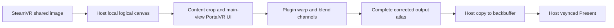

# PortalVR output plugins

This is the authoritative reference for PortalVR's output-plugin interface,
ABI **1.0**, Windows x64 SteamVR host. It covers installation and operation,
the full C ABI, rendering/projection contracts, and implementing an independent
vendor-SDK adapter. Other plugin categories and Linux/OpenXR hosts are outside
this version's scope.

The host implementation and SDK-free example have build and automated WARP
coverage. Licensed vendor-SDK, optical alignment, live SteamVR/operator-window,
hotplug/recovery and hardware timing checks remain deployment validation gates.
No proprietary SDK adapter, runtime, license or calibration data is supplied.

## Getting the developer kit

Use a PortalVR build that supports output plugins and its `output-plugin-sdk`
folder beside the SteamVR driver. Older builds may not include the host or kit.
It contains `include/portalvr/portal_output_plugin.h`, a standalone CMake
example under `docs/developer/output-plugin-v1`, and offline guides. The header
at the end of this reference freezes the ABI 1.0 declarations; the installed
kit's header must match the ABI version supported by your PortalVR release.
The example does not need PortalVR source, import libraries or a vendor SDK.

Build the example from the SDK root using Visual Studio 2022 C++ Build Tools,
Windows SDK and CMake 3.25 or newer:

```powershell
cmake -S docs/developer/output-plugin-v1 -B build -A x64
cmake --build build --config Release --parallel 4
ctest --test-dir build -C Release --output-on-failure
```

Use an external build directory when the SDK is installed under Program Files.
The resulting `build/package/org.portalvr.example.passthrough` folder is an
installable example. Its optional private configuration is a text file with
one integer channel count from 1 to 64. It describes horizontal atlas rectangles
and copies the whole image unchanged; it provides no optical correction.

## Install a package

1. Follow the plugin author's SDK runtime, licensing and calibration setup.
2. Stop SteamVR before installing or replacing plugin binaries.
3. Copy the author's entire package folder into
   `%LOCALAPPDATA%\PortalVR\output-plugins`. Its folder name must match the
   `id` in `plugin.json`. Application-local packages may instead reside in
   `steamvr-portalvr\output-plugins` beside the driver manifest. Do not install
   the same ID in both locations.
4. Start PortalVR. In Display settings choose **Output plugins...**, then
   rescan, select the plugin, enable it, and enter its absolute configuration
   file path. The file's format and calibration references belong to the
   plugin author; PortalVR does not parse that private configuration.
5. Select the intended physical display in PortalVR's display settings.
   For several projectors sharing one image, configure their Surround or
   equivalent group first. V1 supports one desktop display target and GPU.
6. Restart SteamVR and the application to adopt the plugin's image/view geometry.

For plugins with inverse pointer mapping, the usual input setup, onboarding and
Escape settings appear as an ImGui overlay on the main view. PortalVR composites
that UI into the logical canvas before the plugin corrects the image.
**Display > Output plugins...** explicitly opens the separate plugin-controls
window; **PortalVR settings** returns to the main-view settings. Plugins without
inverse mapping retain an unwarped interactive fallback. Plugin startup/render
errors expose host-owned recovery controls.

## Calibration changes

Use the plugin author's calibration tools and private configuration to select
the installation's current complete export. Choose **Reload calibration** to
request a reload at the next composed application frame. Some SDKs require a
restart even for otherwise compatible changes; their plugin reports that status.

When geometry is unchanged, a new complete calibration replaces all channels
together. A bad/incomplete export leaves the previous calibration active.
Changes to source dimensions, frustum, camera basis, color transfer, output
size or channel destinations require restarting SteamVR and the application.
Applications may cache their initial projection. Never assume recalibrating
files alone has updated the running application's camera.

Keep the calibrated desktop resolution and display target stable. A target
disconnect or incompatible resize stops corrected output; restore the target
or restart with matching calibration. The host does not stretch a calibrated
atlas to fit another resolution.

## Recover from an error

Missing plugin/SDK/license, invalid calibration or rendering failure produces
black projector output and a status in the operator window. There is no silent
switch to unwarped or stereo fallback output. Follow the plugin author's
instructions for SDK-specific errors, then reload or restart as appropriate.

**Disable now** stops the active plugin and saves it disabled. A restart is
still needed to restore ordinary source geometry. If SteamVR cannot start due
to a broken or hanging native plugin, stop it and set `output_plugin.enabled`
to `false` in `%LOCALAPPDATA%\PortalVR\portalvr_config.json`, then restart.
Keep your other configuration intact. Native plugin crashes/hangs cannot be
safely recovered by unloading code that is still executing.

## Required coverage

The interface supports both a calibrated perspective view and a shared wide
image distributed across calibration channels. Channel counts, SDK entry points,
calibration paths and resolutions are provided by the plugin rather than
hard-coded by the host.

| Configuration | Required plugin surface |
| --- | --- |
| Combined perspective calibration covering a projector installation | Declare a single calibrated mono frustum and view basis before SteamVR/application rendering begins; warp its image |
| Two or three orthographic render channels sharing a panorama | Declare one logical canvas and N output rectangles; feed the whole panorama to each SDK channel and assemble their results |
| New calibration after recalibrating the installation | Resolve a consistent current export on startup; support transactional reload when geometry is unchanged |
| Window resize, display disconnect, or D3D device recreation | Explicit detach and attach lifecycle, generation checks, and validation against the actual physical target |

An SDK render channel is not necessarily one physical projector: a combined
export can cover several projectors. It is also not an eye or a Windows monitor.

V1 supports one logical mono view, one Windows desktop target, one D3D device,
and one swap chain. The desktop target may be a Surround/Eyefinity group.
Independent per-projector perspective views, multiple swap chains/adapters,
stereo projection, Linux/Vulkan, and remote image generators are outside v1.
A plugin must return `UNSUPPORTED` for calibration requiring those features.
Calibrated projection is fixed for an application session. SDK modes requiring
per-frame eyepoint/frustum updates before application rendering also need a
future image-generation integration; a post-submit callback cannot provide it.
Generating N independent views would require changes to image generation as
well as the plugin ABI; it cannot be promised by adding a final image filter.

## Ownership boundary

| PortalVR owns | Third-party plugin owns |
| --- | --- |
| Display selection, HWND, D3D device/context, swap chain, vblank and exactly one Present | Official vendor SDK calls, runtime discovery/loading and license checks |
| SteamVR source dimensions, eye viewports, frustum and view-basis application | Reading supported calibration exports and translating their metadata |
| Logical scene composition, source synchronization and operator UI | Per-channel SDK objects, intermediate channel textures, warp/blend and assembly |
| ABI validation, activation, failure display and GPU lifecycle | A private configuration format, calibration snapshots and optional file watching |
| Host package, public SDK-free header and template | Independently distributed plugin, its dependencies, build instructions and supported SDK versions |

No vendor headers, binary structure replicas, undocumented exports, SDK DLLs,
license keys, machine calibration, or SDK auto-downloads enter the host SDK or
PortalVR package. A plugin author uses the vendor's supported SDK under their
own applicable development and distribution rights. The plugin exposes only
Portal-owned geometry and D3D resource interfaces. Successful ABI loading is
not a license check; the plugin reports SDK/license availability explicitly.

## Rendering placement



The plugin is an alternative output backend, mutually exclusive with Leia
weaving, SBS and anaglyph output. It selects the host's full-width mono source
path explicitly. An ultra-wide projector desktop must not be inferred to be
an SBS stereo display. No-plugin configurations retain the existing paths.

The host renders into a stable local input texture with an SRV and creates a
distinct plugin output texture with an RTV. These resources stay at fixed
addresses during an attachment. The plugin may allocate its own per-channel
textures and copy them into its output atlas. Destination rectangles must be
positive, disjoint and inside the declared output bounds; gaps are black.
Overlapping projected light on the physical screen is handled by SDK blend
data, not overlapping atlas rectangles.

Input is the whole logical panorama, not the left half of a stereo texture.
Each SDK channel may sample the same full input image; host code must not
pre-crop it merely because the destination rectangles are adjacent.
The plan supplies the effective logical source dimensions. If SteamVR submits
a different actual render resolution, resample its complete mono viewport into
that canvas while preserving the negotiated frustum. Never apply a second eye
crop or an aspect/FOV change to accommodate supersampling.

PortalVR copies the SteamVR image into its own resource under the existing
shared-texture/keyed-mutex rules and releases that mutex before calling the
plugin. The direct shared-SRV fast path must be disabled for plugin output.
The plugin never sees a compositor handle or acquires a keyed mutex.

Every successful render must produce the entire output, including black gaps
and alpha 1. The host clears the plugin output first and only copies it to the
backbuffer after `render` returns `OK`. No channel may independently present.
This prevents partial channel results from becoming a displayed frame on a
reported SDK error. GPU removal still requires the normal device-loss path.

V1 uses single-sample, single-mip RGBA8_UNORM or BGRA8_UNORM textures. The plan
declares whether stored values are sRGB-encoded or linear. SRV/RTV formats are
UNORM, not automatic sRGB views. The host performs any conversion into/out of
this contract exactly once; the SDK adapter configures its photometric and
gamma behavior accordingly. HDR, typeless, multisample and other formats are
rejected. Channel rendering must not introduce another implicit gamma pass.

## Projection before rendering

`prepare` reads a calibration snapshot without a D3D binding. `describe`
publishes source/output sizes, format, transfer, channel rectangles and one of
two projection contracts:

- `PROJECTION_HOST`: the existing host camera/FOV produces a shared panorama;
  the plugin only corrects its display geometry. Normal content FOV and crop
  controls can remain available.
- `PROJECTION_CALIBRATED_MONO`: use the supplied signed OpenVR frustum tangents
  and `head_from_view` pose identically for both eyes. The pose is right-handed,
  +X right, +Y up, -Z forward, metres, quaternion x/y/z/w. The plugin translates
  SDK angles/units into this contract using its configured calibration-to-host
  basis. The host composes it with tracking; it does not expose SDK conventions
  to pose consumers. Ordinary IPD offsets, display-aspect FOV overrides,
  head-window crop and FOV preview must not change this calibrated projection.

The host validates finite values, a normalized orientation, tangent ordering,
supported dimensions/formats, adapter compatibility and all channel bounds.
Declared output width/height must match the selected physical target exactly;
the host never stretches a calibrated atlas to fit another desktop size. It
checks actual D3D feature-level texture limits and memory-size arithmetic after
device creation and before publishing geometry.

The existing presentation worker bootstraps the plugin during driver activation,
before publishing SteamVR render-target, viewport, projection and eye-transform
properties. The worker validates GPU attachment before returning its committed
geometry. Query methods use an immutable session snapshot and do not call the
DLL. Resizing or disabling the plugin does not change application-facing source
geometry midway through that session.

Different per-channel perspective frusta do not become correct by splitting
one rendered view. V1 accepts multiple shared-canvas channels, or a supported
combined single-view calibration. The adapter must distinguish these during
preparation instead of guessing from a filename.

## C ABI

The [complete public header](#abi-10-header) below defines the binary layouts. It has one exported function, `portal_output_plugin_get_api`,
which returns metadata and a function table. No compiler-specific C++ objects,
STL containers, exceptions, vendor types or host allocation routines cross the
boundary. Standard D3D11/DXGI COM interfaces are the platform resource contract.
Objects allocated in the DLL are destroyed through that DLL's `destroy`.

| Entry | Contract |
| --- | --- |
| `get_api` | Metadata-only negotiation; no SDK loading, service calls or device work |
| `prepare` | Validate config/license/calibration and return an immutable opaque CPU plan; failure returns a null plan |
| `describe` | Caller-owned descriptor and two-call channel enumeration; no returned vendor pointers |
| `attach` | Bind a prepared plan to host D3D resources and initialize SDK GPU objects |
| `render` | Consume the current logical canvas and produce complete output using the attached generation |
| `detach` | Idempotently release all GPU and swap-chain-buffer references, including after failed attach |
| `destroy` | Release the detached CPU plan, SDK handles and workers |
| `map_pointer` | Optional physical-output to logical-input mapping for projected UI; capability bit and function pointer must agree |

All v1 parameter-structure layouts and channel-array stride are frozen. A
layout change requires a new ABI major or a separately named new function and
new structure; an implementation must not append fields to channel entries
and index an old caller's array with a larger stride. `struct_size` checks
protect fixed v1 prefixes and packing. A minor release may append function
pointers to the API table without changing existing signatures or mandatory
entries. Query writes only the supported table prefix fitting the host's
capacity, reports its initialized byte count, and never writes beyond it.
An unsupported major leaves the output untouched. The current sample supports
only the complete v1.0 table.

V1 is Windows x64 with C linkage, `__cdecl`, 8-byte packing, fixed-width
integers and UTF-8 strings/absolute paths. Fixed metadata arrays must be
terminated within their capacity. The host copies the returned API table while
the module stays loaded. It rejects a wrong ID, short table, missing mandatory
callback, unsupported major or invalid capability declaration before `prepare`.

All calls except the metadata query run serially on the presentation worker,
including CPU preparation and destruction. UI events enqueue commands to that
worker. Plugin workers may watch files or prepare CPU data, but must not use
the host immediate context. They may call the copying `log` and coalescing
`request_reload` host callbacks; neither reenters the DLL. Workers must stop
and join before `destroy` returns. Callback storage remains valid through that
return and then becomes unusable. No other host services are exposed in v1.

## D3D lifetime and state

`attach` supplies the immediate context, input texture/SRV, output texture/RTV,
and a unique nonzero binding generation. It also supplies the real HWND and
swap chain for SDKs that require them during device initialization.
Those two interfaces are for initialization compatibility only: the plugin
must never call Present, ResizeBuffers, change fullscreen state, or render
directly into an acquired backbuffer. An SDK mode that cannot obey this rule
is unsupported. The SDK-free headless test supplies null HWND/swap chain.

Bindings are borrowed but may be AddRef'd, including by SDK input/output
setters, until `detach`. Per-call structs and config-path strings cannot be
retained as pointers. `render` only gets a frame ID, host monotonic time and
binding generation because image resources are already stable in the binding.
Old generations are rejected even when a texture address is reused.

The host establishes clean D3D state before each plugin operation that can
touch the context, clears it afterward, and explicitly rebinds all required
host state. Implementation must audit existing renderer state assumptions;
ClearState is not a GPU wait. D3D11.1 context-state swapping can replace this
with measured/tested state isolation. See Microsoft's
[context-state API](https://learn.microsoft.com/en-us/windows/win32/api/d3d11_1/nf-d3d11_1-id3d11devicecontext1-swapdevicecontextstate)
and [context threading rules](https://learn.microsoft.com/en-us/windows/win32/direct3d11/overviews-direct3d-11-render-multi-thread-intro).

For resize, retarget, device loss or shutdown, stop new renders, complete or
abandon queued GPU work as appropriate for device loss, unbind context state,
call `detach` on every attached/candidate plan, release host views/textures,
then resize or recreate. The host must wait for successful queued GPU work
before freeing an active SDK instance/module. Device loss does not require
waiting forever on a removed device. Reattach with new resources and a new
generation only after validating their descriptors. This ordering also
releases SDK-owned backbuffer references required by
[ResizeBuffers](https://learn.microsoft.com/en-us/windows/win32/api/dxgi/nf-dxgi-idxgiswapchain-resizebuffers).

## Calibration reload

The plugin resolves the installation's current calibrated export at startup.
It must preserve its associated files and channel mapping as one snapshot.
Choosing individual files solely by modification time is not a consistency
rule. The host does not know vendor directories, mesh formats or channel suffixes.

Manual reload is a host control; optional file watching requests the same
operation through `request_reload`. On the presentation worker:

1. Prepare a candidate with `PREPARE_RELOAD` while leaving the old plan intact.
   If the SDK cannot stage independent plans safely, return `RESTART_REQUIRED`.
2. Describe/validate the candidate and compare all source dimensions,
   projection, transfer/format, output dimensions and channel destinations.
   Compare semantic fields, not structure padding or opaque SDK pointers.
   Any change to the application-facing image/view or target layout requires
   restarting SteamVR and the application. Keep the old plan until that restart.
3. With unchanged geometry, allocate separate candidate output/bindings and
   attach/test the candidate against the current input. Publish only a complete
   successful output. Atomically switch the active plan at a frame boundary.
4. Drain old queued work, detach/destroy the old plan, then release old resources.
   A failed candidate is detached/destroyed without mutating the old plan.

Mesh or blend changes can therefore reload without a new application view.
Resolution, frustum or view-basis changes cannot silently use images rendered
with an old camera. `GetProjectionRaw` already notes that applications may
cache initial projection; a dynamic update notification is not proof that all
applications have adopted new geometry.

File reading and SDK initialization belong to prepare/attach, not per-frame
rendering. Normal rendering queues GPU commands without CPU readback or a
host-inserted GPU wait. Allocate reusable channel resources during attach.
V1 permits a reload pause; present a black frame before blocking
setup if the SDK needs it. It does not promise stall-free asynchronous SDK
initialization. Native callbacks have no safe forced timeout or sandbox:
an untrusted, crashing or nonreturning DLL can crash/hang vrserver. They are
explicitly installed trusted native extensions. Out-of-process crash isolation
would need another transport/resource-sharing design.

## Operator experience and failures

When a plugin advertises inverse pointer mapping, normal PortalVR onboarding
and Escape settings appear on the main view. The host renders the UI into a
transparent intermediate, handles premultiplied-alpha blending and conversion
to the plan's declared transfer, and composites it into the logical canvas
before calling the plugin. The plugin receives the same opaque image contract,
now including the UI; there is no additional UI resource or ABI entry point.
No projector UI is drawn directly onto the corrected backbuffer.

The separate operator window is for explicitly opened output-plugin controls,
failure recovery, and the interactive fallback when inverse mapping is absent.
For a plugin with mapping, Escape and the **PortalVR settings** action return
from plugin controls to ordinary settings on the main view.

### Pointer mapping for main-view interaction

`map_pointer` remains optional in ABI 1.0. To retain the main-view mouse UI, set
`PVR_OUTPUT_CAP_POINTER_MAPPING` and provide a working callback. It converts
physical output pixels with a top-left origin into logical input-canvas pixels
using the active plan's calibration snapshot. Returned valid positions must be
finite and inside the input canvas. If a location has no unambiguous inverse,
return `valid = 0`; the host suppresses interaction there and can still clear
held buttons. Identity mapping is appropriate only for unchanged geometry with
matching input/output pixel coordinates.

Without the capability/callback, PortalVR keeps interactive onboarding and
settings in an unwarped window. The host never treats raw physical coordinates
as logical coordinates for a warped image. Test the inverse alongside the mesh
and update both together during calibration reload.

Selected-plugin startup/render failure produces black projector output and a
host-owned operator status with a disable/reload/restart action. It never
silently switches a calibrated installation to ordinary SBS, Leia or unwarped
output. A failed reload preserves the previous active calibration. License,
SDK-missing, calibration, target-mismatch and device-loss results have distinct
statuses; detailed vendor errors are copied to logs without license secrets.
Normal output resumes when the user explicitly disables the plugin.

## Installation and selection

Install one package per plugin ID under a user-selected or application plugin
root, with a manifest and a private DLL/dependency directory. For example:

```text
output-plugins/com.example.projector/
  plugin.json
  bin/win64/projector-output.dll
  bin/win64/<authorized dependencies>
  README.txt
```

```json
{
  "schema": 1,
  "id": "com.example.projector",
  "name": "Projector output",
  "abi_major": 1,
  "entry": "bin/win64/projector-output.dll",
  "platform": "windows-x64-d3d11"
}
```

Manifest parsing is data-only; discovery never loads every DLL. The user must
select/enable an ID. Resolve entry paths inside their package, reject traversal
and links escaping the package, and load the selected absolute path with narrow
[LoadLibraryExW search flags](https://learn.microsoft.com/en-us/windows/win32/api/libloaderapi/nf-libloaderapi-loadlibraryexw).
Do not search the current directory or PATH. The plugin resolves vendor runtime
paths itself and does not change process-wide DLL search state. A required SDK
installation outside the package is supported without redistributing it.

Persistent host configuration:

```json
{
  "output_plugin": {
    "enabled": true,
    "id": "com.example.projector",
    "config_path": "C:/Installation/Projectors/output.json"
  }
}
```

Vendor settings live in that private config file. Use machine-local references
to current calibration. Keep installation-specific exports outside the PortalVR installer.
Plugin binaries are replaced only with SteamVR stopped. V1 supports calibration
reload, not live DLL unloading/replacement. SDK-runtime identity/version or
global license-context changes also require restart; the adapter must report
RESTART_REQUIRED instead of replacing those behind an active plan. Host
configuration defaults disabled.

## Implement a licensed SDK adapter

Use the public `include/portalvr/portal_output_plugin.h` and copy the example
into your own repository. If its directory layout differs, pass
`-DPORTAL_OUTPUT_PLUGIN_INCLUDE_DIR=ABSOLUTE_SDK_INCLUDE_DIRECTORY` to CMake.
Build a separate DLL
with the same exported `portal_output_plugin_get_api` function. Use your own
plugin ID, name and version. Integrate the vendor's official headers and
libraries privately; do not add those types to the public header. Include a
manifest following the design, a supported-SDK-version statement, and your
own build and installation instructions.

Replace these sample operations:

| Operation | SDK adapter implementation |
| --- | --- |
| `prepare` | Resolve your private config and current complete calibration set; check runtime/license; build an immutable CPU snapshot. Stage independent state during reload or return RESTART_REQUIRED. |
| `describe` | Translate calibration into whole input canvas dimensions, output atlas/channel rectangles, pixel transfer and optional combined single-view frustum/basis. Reject independent multi-view calibrations in v1. |
| `attach` | Initialize SDK device objects with the supplied D3D11 device/context and, where required, the host swap chain/HWND. Bind stable full-canvas input and your per-channel outputs. Return failure if the SDK cannot render without owning Present. |
| `render` | Validate the generation. For each channel, warp/blend the entire input into a channel texture, then copy it to its declared atlas rectangle. Return OK only when every channel succeeded. |
| `detach` | Release all SDK GPU bindings, backbuffer references and plugin-created GPU resources. Be safe after partial attach failure and repeated calls. |
| `destroy` | Join workers, free CPU calibration/SDK handles and release runtime DLL references. |
| `map_pointer` | Invert calibrated physical-output positions to logical canvas positions for main-view mouse interaction. Set the matching capability only with a working inverse; otherwise use a null callback and the host's unwarped UI fallback. |

An abstract frame loop is:

```text
validate generation
for each calibrated render channel:
    bind its private output texture and viewport
    give SDK the complete logical input texture
    invoke supported SDK warp/blend with presentation disabled
    on any failure: return a non-OK result
    unbind channel output and copy it into the declared atlas rectangle
return OK
```

Those are integration steps, not assumed vendor function names. Use the
supported functions from your licensed SDK. A combined single-view calibration
and multiple shared-canvas channels require different metadata handling.
Do not treat adjacent atlas rectangles as matching source crops, or combine
independent calibrated camera views into one by averaging their frusta.

### Adapter packaging and operation

Keep your SDK include/library paths in your own CMake configuration and any
redistributed dependencies inside your plugin package as authorized. An
externally installed SDK runtime is also supported: load it by an explicit
validated absolute path. Do not modify vrserver's process-wide DLL search path. Windows still reuses
already-loaded module basenames: use vendor-supported unique names or side-by-side
assemblies for conflicting dependencies, and restart for SDK runtime changes.
The host package includes no SDK runtime or calibration data.

Your private configuration should identify the installation's active profile
or an explicit complete channel set. Resolve relative calibration references
against that configuration/profile directory. Convert Windows paths at the
boundary using UTF-8-aware APIs. Keep licensing credentials out of logs and
error messages. Keep installation-specific paths out of released packages.

An operator selects the plugin ID, the host display target and your private config, then restarts SteamVR and
the application for activation. Calibration with unchanged geometry may reload
atomically; changes in source size, view basis/frustum or target layout require
a restart. A vendor installation with incompatible graphics or channel modes
must report UNSUPPORTED instead of drawing an approximate fallback.

Validate your adapter on an authorized SDK installation and calibrated physical
projectors. Use grid/seam and color-ramp captures for all declared channel
layouts, plus missing-license/runtime and device-loss tests. The SDK-free smoke
test establishes only the sample ABI and resource lifecycle contract.
## Acceptance gates

Before deploying an SDK adapter, validate these checks on the real host in
addition to the SDK-free smoke test. Automated coverage alone is insufficient:

- No plugin installed/disabled: existing 2D, SBS, anaglyph and Leia behavior and
  pacing remain unchanged; no vendor DLL load or source-resolution change.
- Negative DLL/ABI tests: absent export, wrong architecture, short table,
  wrong ID, invalid counts/bounds, nonfinite frustum, unsupported source mode,
  malformed config and missing SDK/license produce clear host-owned statuses.
- Golden grid, channel-ID/color ramps and seam checks for two and three outputs,
  including 7680 by 1600, unequal channel widths and a combined perspective
  calibration. Verify the whole image reaches each SDK channel as intended.
- Actual application geometry: render-target size, both eye viewports, signed
  tangents and view basis agree with the plan before the first application frame.
- sRGB/linear ramp tests show no duplicated transfer or blend pass. A deliberately
  state-clobbering plugin does not corrupt the next host/UI render.
- Render failure after one channel cannot display a partial atlas. The plugin
  never Presents, resizes or changes display selection; host Present count stays one.
- Repeated resize, minimize/restore, hotplug, retarget, device loss and unload
  release cached SDK references; stale generations cannot render.
- Successful same-geometry reload commits all channels together. Incomplete
  exports/failed candidates preserve the old plan. Geometry changes request
  SteamVR/application restart, including applications caching their projection.
- Unicode paths, side-by-side plugin versions, absent optional pointer mapping,
  worker shutdown and plugin dependency lookup follow the documented contracts.
- With mapping, normal onboarding and Escape settings remain on the main view.
  Check click/scroll alignment, finite in-bounds inverse coordinates, invalid
  locations, and mapping consistency after reload. Without mapping, verify the
  unwarped interactive fallback. Explicit plugin controls and error recovery
  must remain accessible.
- A licensed integrator validates the supported SDK on its physical calibrated
  projector installation. A pass-through/WARP test cannot establish optical alignment.
- Benchmark CPU/GPU frame time, missed vblanks and memory at full two/three-output
  resolutions. The test's readback is a pixel-verification step, not a runtime path.


## Compatibility and validation record

This reference was checked against the output-plugin host and ABI 1.0 header
on November 14, 2026. Release driver builds passed with the MCP feature enabled
and disabled. Automated production-host checks cover manifest/ABI rejection,
Unicode paths, channel rectangles, projection validation, RGBA/BGRA and color
transfer, state isolation, partial-output rejection, transactional reload,
worker shutdown, cached backbuffer release, generations and fresh-device
attachment. Full-resolution WARP checks cover two and three channels at
7680 by 1600. The packaged example also builds independently using public files.

The main-view UI behavior above uses the existing ABI 1.0 pointer-mapping
capability. Its exported table, structures and header are unchanged. Host UI
routing and transparent overlay blending have regression coverage, including
linear and sRGB transfer. A local SDK-free test plugin also displayed normal
onboarding over the main image at 3840 by 2160; this does not validate another
plugin's inverse mapping, optical calibration or hardware timing.

These checks do not establish live application geometry, optical alignment,
physical vblank pacing, vendor licensing behavior or projector recovery.
Run the deployment acceptance checks above with the actual SDK and hardware.

## ABI 1.0 header

Save the following as `portalvr/portal_output_plugin.h`, or use the identical
header from the developer kit. Its BSL-1.0 license identifier applies to the
header and SDK-free example. For a different ABI version, use that version's
documented header; do not change layouts or export names privately.

```c
/* Copyright 2026, Portal
 * SPDX-License-Identifier: BSL-1.0
 * ABI 1.0: PortalVR Windows SteamVR output plugins.
 * Windows x64, default 8-byte packing, C linkage, no vendor SDK dependencies.
 */
#ifndef PORTAL_OUTPUT_PLUGIN_H
#define PORTAL_OUTPUT_PLUGIN_H

#include <stdint.h>

#if defined(_WIN32)
#define PVR_OUTPUT_CALL __cdecl
#if defined(PVR_OUTPUT_PLUGIN_BUILD)
#define PVR_OUTPUT_EXPORT __declspec(dllexport)
#else
#define PVR_OUTPUT_EXPORT
#endif
#else
#define PVR_OUTPUT_CALL
#define PVR_OUTPUT_EXPORT
#endif

#ifdef __cplusplus
extern "C" {
#endif

typedef struct ID3D11Device ID3D11Device;
typedef struct ID3D11DeviceContext ID3D11DeviceContext;
typedef struct ID3D11Texture2D ID3D11Texture2D;
typedef struct ID3D11ShaderResourceView ID3D11ShaderResourceView;
typedef struct ID3D11RenderTargetView ID3D11RenderTargetView;
typedef struct IDXGISwapChain IDXGISwapChain;
typedef struct pvr_output_plan pvr_output_plan;

#define PVR_OUTPUT_ABI_MAJOR 1u
#define PVR_OUTPUT_ABI_MINOR 0u
#define PVR_OUTPUT_ENTRY_POINT "portal_output_plugin_get_api"
#define PVR_OUTPUT_MAX_CHANNELS 64u

typedef int32_t pvr_output_result;
enum {
    PVR_OUTPUT_OK = 0,
    PVR_OUTPUT_BUFFER_TOO_SMALL = 1,
    PVR_OUTPUT_RESTART_REQUIRED = 2,
    PVR_OUTPUT_INVALID_ARGUMENT = -1,
    PVR_OUTPUT_UNSUPPORTED_ABI = -2,
    PVR_OUTPUT_UNSUPPORTED = -3,
    PVR_OUTPUT_SDK_UNAVAILABLE = -4,
    PVR_OUTPUT_LICENSE_UNAVAILABLE = -5,
    PVR_OUTPUT_CALIBRATION_INVALID = -6,
    PVR_OUTPUT_TARGET_MISMATCH = -7,
    PVR_OUTPUT_DEVICE_LOST = -8,
    PVR_OUTPUT_FAILED = -9,
    PVR_OUTPUT_STOPPING = -10
};

enum {
    PVR_OUTPUT_CAP_POINTER_MAPPING = 1u << 0,
    PVR_OUTPUT_PREPARE_RELOAD = 1u << 0,
    PVR_OUTPUT_LOG_INFO = 0,
    PVR_OUTPUT_LOG_WARNING = 1,
    PVR_OUTPUT_LOG_ERROR = 2,
    PVR_OUTPUT_PROJECTION_HOST = 0,
    PVR_OUTPUT_PROJECTION_CALIBRATED_MONO = 1,
    PVR_OUTPUT_TRANSFER_SRGB = 1,
    PVR_OUTPUT_TRANSFER_LINEAR = 2
};

#pragma pack(push, 8)

/* Callbacks copy their arguments and return promptly; callable from workers.
 * userdata and these functions remain valid until every plan is destroyed.
 * request_reload only enqueues a request; it never reenters plugin code.
 */
typedef struct pvr_output_host {
    uint32_t struct_size;
    void *userdata;
    void(PVR_OUTPUT_CALL *log)(void *userdata, uint32_t level, const char *message_utf8);
    pvr_output_result(PVR_OUTPUT_CALL *request_reload)(void *userdata);
} pvr_output_host;

/* Selected by the user/host. Desktop coordinates are physical pixels.
 * adapter_luid is the Windows LUID bit pattern, not a pointer or ordinal.
 * stable_id_utf8 is an opaque host display identity, not a monitor ordinal/path.
 */
typedef struct pvr_output_target {
    uint32_t struct_size;
    uint32_t width;
    uint32_t height;
    int32_t desktop_x;
    int32_t desktop_y;
    uint32_t refresh_numerator;
    uint32_t refresh_denominator;
    uint64_t adapter_luid;
    char stable_id_utf8[128];
} pvr_output_target;

typedef struct pvr_output_prepare_info {
    uint32_t struct_size;
    uint32_t flags;
    /* Absolute UTF-8 path, or NULL. Format and interpretation belong to plugin. */
    const char *config_path_utf8;
    pvr_output_target target;
} pvr_output_prepare_info;

/* Signed OpenVR tangents: left < right and top < bottom, top normally negative.
 * Pose maps view coordinates into head coordinates: RH +X right,+Y up,-Z forward;
 * metres and normalized quaternion x/y/z/w. Applies equally to both eyes.
 * All fields except mode are ignored for PROJECTION_HOST.
 */
typedef struct pvr_output_projection {
    uint32_t mode;
    float left;
    float right;
    float top;
    float bottom;
    float head_from_view_position_m[3];
    float head_from_view_orientation_xyzw[4];
} pvr_output_projection;

/* Immutable plan. v1 supplies ONE mono canvas, including for N projectors.
 * dxgi_format is RGBA8_UNORM (28) or BGRA8_UNORM (87). Source/output have the
 * same format and transfer. Host owns conversion to this declared contract.
 */
typedef struct pvr_output_plan_desc {
    uint32_t struct_size;
    uint32_t input_width;
    uint32_t input_height;
    uint32_t output_width;
    uint32_t output_height;
    uint32_t dxgi_format;
    uint32_t transfer;
    uint32_t channel_count;
    pvr_output_projection projection;
} pvr_output_plan_desc;

/* Rectangles are disjoint destinations in the physical output atlas, not
 * source crops. Each SDK channel can consume the entire input panorama.
 */
typedef struct pvr_output_channel {
    uint32_t struct_size;
    uint32_t index;
    uint32_t x;
    uint32_t y;
    uint32_t width;
    uint32_t height;
    char id_utf8[64];
} pvr_output_channel;

/* Stable host-owned resources for one attachment; pointers are borrowed.
 * Plugin may AddRef until detach, including resources cached by its SDK.
 * swap_chain/native_window support SDK initialization only; never Present,
 * resize, retarget the window, or draw into an acquired swap-chain buffer.
 */
typedef struct pvr_output_d3d11_binding {
    uint32_t struct_size;
    uint64_t generation;
    ID3D11Device *device;
    ID3D11DeviceContext *immediate_context;
    IDXGISwapChain *swap_chain;
    void *native_window;
    ID3D11Texture2D *input_texture;
    ID3D11ShaderResourceView *input_srv;
    ID3D11Texture2D *output_texture;
    ID3D11RenderTargetView *output_rtv;
} pvr_output_d3d11_binding;

typedef struct pvr_output_frame {
    uint32_t struct_size;
    uint64_t binding_generation;
    uint64_t frame_id;
    uint64_t monotonic_time_ns;
} pvr_output_frame;

typedef struct pvr_output_pointer {
    uint32_t struct_size;
    /* Top-left origin, physical output pixels in; logical canvas pixels out.
     * valid=0 means no unambiguous inverse (outside surface/overlap/etc.). */
    float output_x;
    float output_y;
    uint32_t valid;
    float input_x;
    float input_y;
} pvr_output_pointer;

/* All functions below run serially on the host presentation thread. Query is
 * metadata-only and may run on the loader thread. No exception crosses this ABI.
 * The DLL owns every opaque plan and destroys it with its own allocator.
 */
typedef struct pvr_output_plugin_api {
    uint32_t struct_size;
    uint32_t abi_major;
    uint32_t abi_minor;
    uint32_t capabilities;
    char id_utf8[64];
    char name_utf8[96];
    char version_utf8[32];
    pvr_output_result(PVR_OUTPUT_CALL *prepare)(const pvr_output_host *host, const pvr_output_prepare_info *info,
                                                pvr_output_plan **out_plan);
    /* Always fills desc and required_count on OK/BUFFER_TOO_SMALL. Call first
     * with NULL channels and capacity=0, then with required_count entries.
     * Caller initializes struct_size of desc and every channel entry.
     */
    pvr_output_result(PVR_OUTPUT_CALL *describe)(pvr_output_plan *plan, pvr_output_plan_desc *desc,
                                                 pvr_output_channel *channels, uint32_t capacity,
                                                 uint32_t *required_count);
    pvr_output_result(PVR_OUTPUT_CALL *attach)(pvr_output_plan *plan, const pvr_output_d3d11_binding *binding);
    pvr_output_result(PVR_OUTPUT_CALL *render)(pvr_output_plan *plan, const pvr_output_frame *frame);
    /* Idempotent, also after failed attach; release every GPU/backbuffer ref. */
    void(PVR_OUTPUT_CALL *detach)(pvr_output_plan *plan);
    /* Requires detach first; stop/join plugin workers before returning. */
    void(PVR_OUTPUT_CALL *destroy)(pvr_output_plan *plan);
    /* Optional; NULL unless CAP_POINTER_MAPPING is set. */
    pvr_output_result(PVR_OUTPUT_CALL *map_pointer)(pvr_output_plan *plan, pvr_output_pointer *point);
} pvr_output_plugin_api;

#pragma pack(pop)

typedef pvr_output_result(PVR_OUTPUT_CALL *pvr_output_get_api_fn)(uint32_t requested_major, uint32_t out_api_bytes,
                                                                  pvr_output_plugin_api *out_api);

/* Only required export. Fill at most out_api_bytes; struct_size records the
 * initialized prefix. Unsupported major leaves output untouched. See guide.
 */
PVR_OUTPUT_EXPORT pvr_output_result PVR_OUTPUT_CALL portal_output_plugin_get_api(uint32_t requested_major,
                                                                                 uint32_t out_api_bytes,
                                                                                 pvr_output_plugin_api *out_api);

#ifdef __cplusplus
} /* extern C */
#endif
#endif
```
